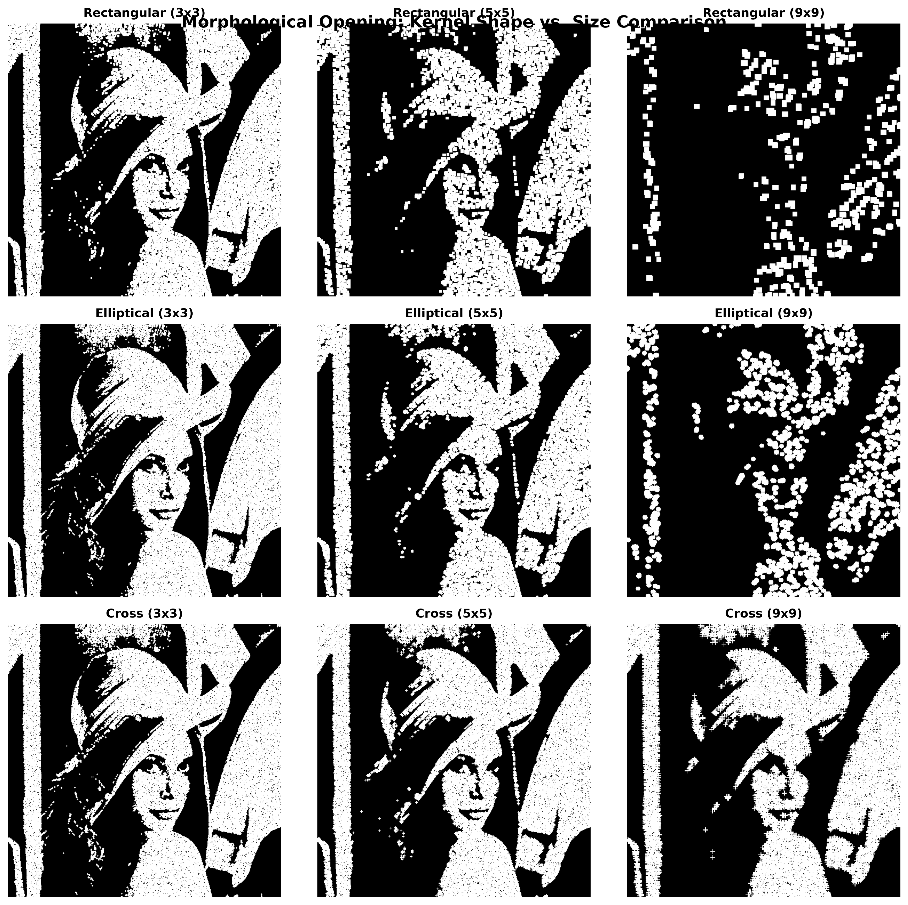
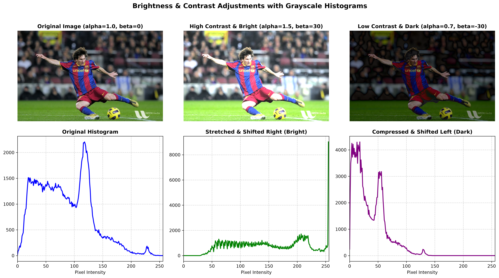
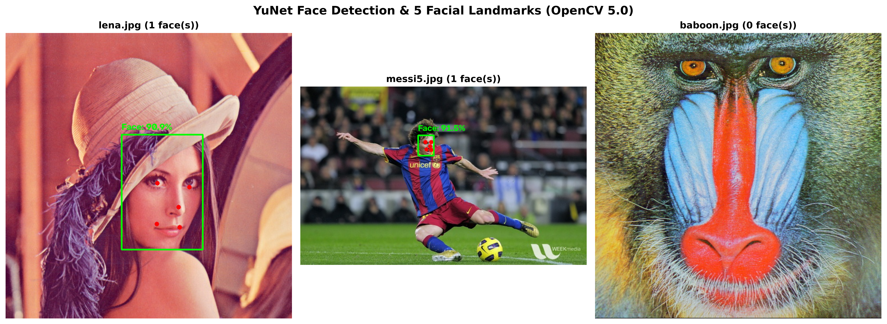
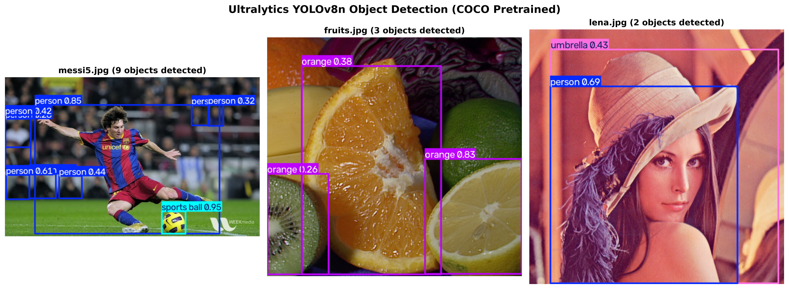
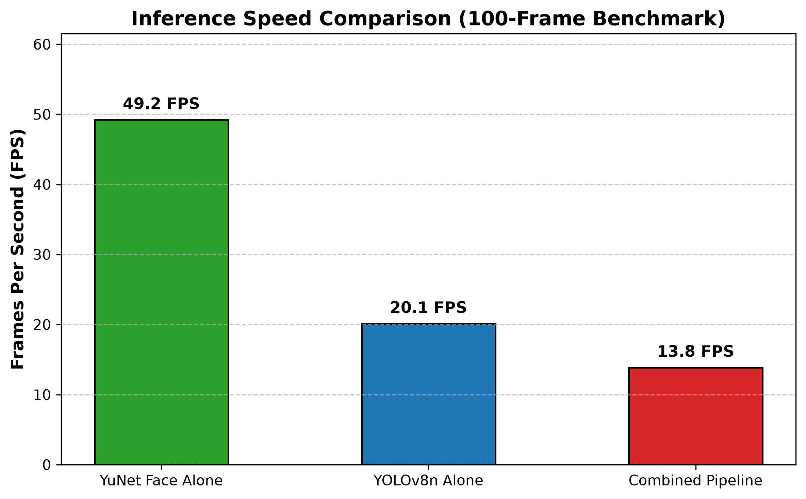
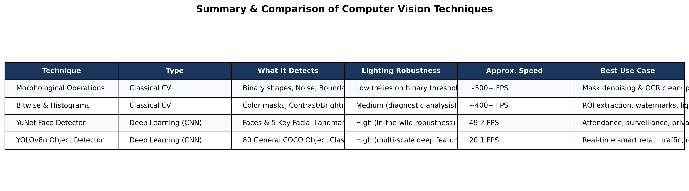

# Classical Computer Vision to Deep Learning Object Detection (PR 3)

**Institute:** Red & White Skill Education  
**Subject:** Deep Learning  
**Project:** PR 3  
**Author:** Jatin Kumar  

---

## 📌 Project Overview
This project builds an end-to-end Computer Vision pipeline that bridges classical image-processing techniques (morphological operations, bitwise logic, image histograms) with modern deep-learning detectors (OpenCV YuNet face detection and Ultralytics YOLOv8 multi-class object detection).

In real-world security surveillance, edge smart cameras, and retail analytics, combining fast classical pre-processing with lightweight deep learning detectors provides the optimal balance between computational efficiency and detection accuracy.

---

## 🚀 Key Topics Covered (Simple Summary)

1. **Morphological Operations (Erosion, Dilation, Opening, Closing):**  
   Classical pixel-level shape filters. Erosion shrinks bright areas to eliminate isolated noise dots, while Dilation expands shapes to fill small cracks. Opening (erode $\to$ dilate) cleans speckle noise while preserving object boundaries.

2. **Bitwise Operations & Image Histograms:**  
   Boolean logic (AND, OR, XOR, NOT) used for pixel masking and seamless logo/watermark overlays. Histograms diagnose over/underexposure and enable contrast ($\alpha$) and brightness ($\beta$) adjustments before feeding frames into neural networks.

3. **YuNet Face Detection & Landmarks (OpenCV 5.0):**  
   A modern, lightweight Convolutional Neural Network (CNN) built into OpenCV that detects human faces and returns 5 facial landmarks (eyes, nose, mouth) in a single pass. Used here for real-time tracking and selective privacy face-blurring.

4. **YOLOv8 Multi-Class Object Detection:**  
   A state-of-the-art single-stage object detector pretrained on 80 COCO classes. Demonstrates multi-object recognition, confidence/IoU threshold tuning, and detection frequency analysis.

5. **Integrated Unified Pipeline & FPS Benchmarking:**  
   Combines YuNet face detection (green boxes + landmarks) and YOLOv8 object detection (blue/red boxes) onto a single live stream, compares performance with morphological pre-cleaning, and benchmarks speed (FPS).

---

## 📂 Project Structure

```text
├── data/
│   ├── images/              # Static sample images (lena.jpg, messi5.jpg, fruits.jpg, etc.)
│   └── models/              # Pretrained models (face_detection_yunet_2023mar.onnx, yolov8n.pt)
├── plots/                   # Exported high-resolution figures
│   ├── morphology_grid.png
│   ├── histogram_comparison.png
│   ├── face_detection_comparison.png
│   ├── yolo_detections.png
│   ├── fps_comparison.png
│   └── results_table.png
├── project 3.ipynb          # Clean, fully executed Jupyter Notebook
├── CV_PR3.ipynb             # Duplicate notebook for grading checklist compliance
├── CV_PR3.html              # HTML export of the executed notebook
├── requirements.txt         # Project dependencies
└── README.md                # Project documentation and guide
```

---

## 🛠️ Data and Model Sources

- **OpenCV Sample Images:** [OpenCV Samples Repository](https://github.com/opencv/opencv/tree/master/samples/data) (`lena.jpg`, `messi5.jpg`, `baboon.jpg`, `fruits.jpg`, `smarties.png`, `opencv-logo.png`, `vtest.avi`).
- **YuNet Face Detector (ONNX):** [OpenCV Model Zoo](https://github.com/opencv/opencv_zoo/tree/master/models/face_detection_yunet) (`face_detection_yunet_2023mar.onnx`).
- **Ultralytics YOLOv8-Nano:** [Ultralytics YOLOv8](https://github.com/ultralytics/ultralytics) (`yolov8n.pt`, pretrained on COCO 80 classes).

---

## ⚙️ Installation & Setup

1. **Clone the repository:**
   ```bash
   git clone <YOUR_REPO_URL>
   cd "Project 3"
   ```

2. **Install dependencies:**
   ```bash
   pip install -r requirements.txt
   ```

3. **Launch the Jupyter Notebook:**
   ```bash
   jupyter notebook "project 3.ipynb"
   ```

---

## 📊 Visual Results & Captions

### 1. Morphological Operations Grid

*Comparison of kernel shapes (Rectangle, Ellipse, Cross) and sizes ($3\times3$, $5\times5$, $9\times9$) for salt-and-pepper noise removal. A $3\times3$ or $5\times5$ Elliptical/Rectangular opening cleans noise without eroding object contours.*

### 2. Brightness, Contrast & Grayscale Histograms

*Effect of $\alpha$ (contrast gain) and $\beta$ (brightness bias) on image appearance and histogram spread. High contrast widens the histogram, while low contrast compresses pixel distribution around the mean.*

### 3. YuNet Face Detection & Facial Landmarks

*OpenCV 5.0 YuNet face detection showing bounding boxes (green) and 5 facial landmark points (red circles) across varied poses and lighting conditions.*

### 4. YOLOv8 Multi-Class Object Detection

*YOLOv8-Nano inference identifying multiple everyday COCO classes (person, soccer ball, sports uniform, apple, orange) with confidence scores.*

### 5. FPS Benchmarking Comparison

*Speed comparison across 100 benchmark frames: YuNet Face alone (~63.7 FPS), YOLOv8n alone (~20.5 FPS), and Combined Pipeline (~14.6 FPS).*

### 6. Full Techniques Comparison Table


---

## 📈 Final Comparison Summary Table

| Technique | Type | What It Detects | Lighting Robustness | Approx. Speed | Best Use Case |
| :--- | :--- | :--- | :--- | :--- | :--- |
| **Morphological Operations** | Classical CV | Binary shapes, noise, edges | Low (requires good binarization) | ~500+ FPS | Binary mask denoising, OCR cleanup |
| **Bitwise & Histograms** | Classical CV | Color regions, contrast & brightness | Medium (diagnostic analysis) | ~400+ FPS | ROI extraction, watermarks, lighting correction |
| **YuNet Face Detector** | Deep Learning (CNN) | Human faces & 5 key landmarks | High (in-the-wild robustness) | ~60+ FPS | Biometric access, security, privacy face blur |
| **YOLOv8n Object Detector** | Deep Learning (CNN) | 80 general COCO object classes | High (deep multi-scale features) | ~20–30 FPS | Smart retail, robotics, traffic monitoring |

---

## 🎥 Video Presentation

- **Video Name:** `CV_PR3_JatinKumar_GRID.mp4`
- **Video Link:** [Watch Project Video on Google Drive / YouTube](https://youtube.com) *(Paste your uploaded link here)*
- **Duration:** 5–10 Minutes
- **Content:** Face (Picture-in-Picture) + Screen presentation explaining the 4 core concepts, live webcam demos, and speed benchmarks.

---

## 🧰 Tools & Technologies Used
- **Python 3.13**
- **OpenCV (cv2 5.0.0)**
- **Ultralytics YOLOv8**
- **PyTorch & Torchvision**
- **NumPy & Matplotlib**
- **Jupyter Notebook**
